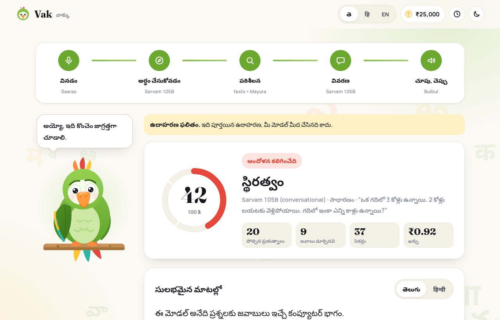
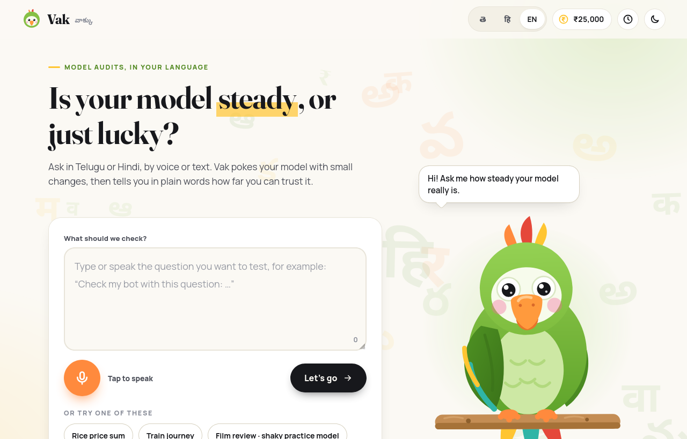
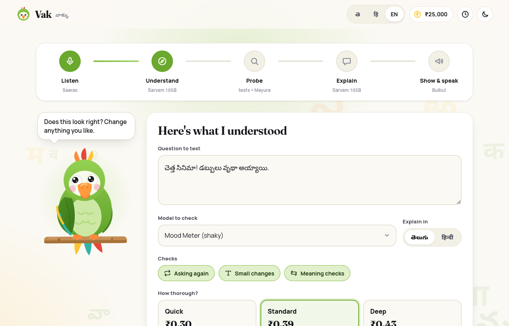
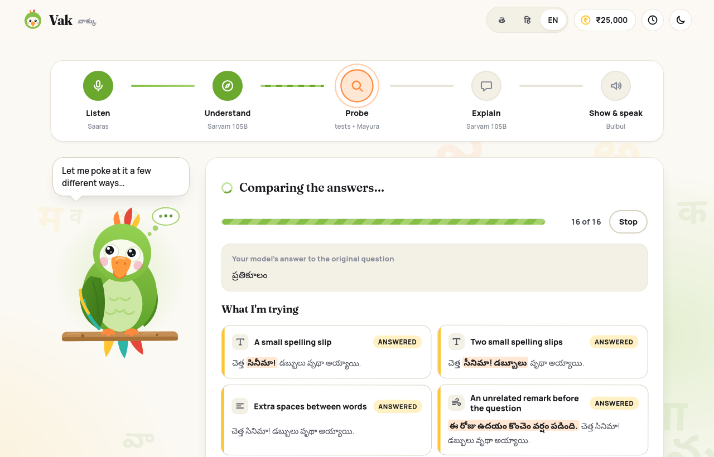
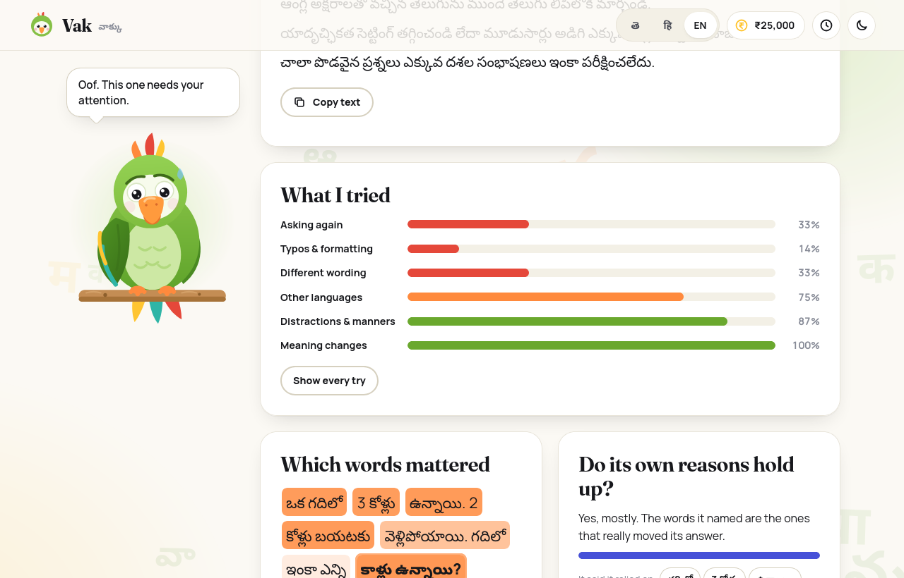
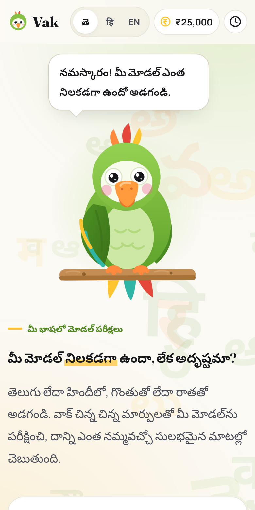

# Vak

Ask in Telugu or Hindi, by voice or by typing. Vak pokes your AI model with small changes,
then tells you in plain words how far you can trust it.

*Vak* (వాక్కు, वाक्) is the Sanskrit word for speech. The parrot on the page is Mitthu.



## What it does

You say something like *"test my bot with this question: …"*, or just paste the question.
Vak then does the following:

1. **Listens.** Voice goes through Sarvam's Saaras speech-to-text. Typed text skips this.
2. **Works out the plan.** Sarvam 105B pulls the question out of what you said, spots a model
   name if you mentioned one ("Gemma", "DeepSeek"), and shows you the plan before anything is spent.
3. **Probes the model.** The same question goes in again and again, changed in small ways:
   a spelling slip, extra spaces, digits in Telugu numerals, Telugu typed in English letters,
   rewording, the Hindi or English version, an unrelated sentence stuck on the front, and a
   couple of "the meaning really did change, so the answer should too" checks. It also takes the
   question apart word by word to see which words the answer leans on.
4. **Explains.** The result is written up in plain Telugu or Hindi, under the writing rules
   from the project brief (below), and checked against them in code.
5. **Shows and speaks.** You get the text, the evidence behind it, and a Bulbul voice that
   reads it aloud while the sentence being spoken is highlighted.

| | |
| --- | --- |
|  |  |
|  |  |



## Running it

You need Python 3.11 or newer and a [Sarvam API key](https://indus.sarvam.ai).

```bash
git clone git@github.com:Mudassiruddin7/Vak.git
cd Vak
python -m venv .venv && source .venv/bin/activate
pip install -e .
cp .env.example .env          # then put your key in SARVAM_API_KEY
python -m vak                 # http://127.0.0.1:8420
```

Two finished example audits ship with the app, so you can look around before spending anything:
open `/?demo=steady` or `/?demo=shaky`. Both are real runs against Sarvam 105B. The shaky one is a
small counting puzzle that the model answers differently depending on the wording and the language.

A few URL switches: `?lang=te`, `?lang=hi` or `?lang=en` for the interface language, and `?still`
to settle every animation (the page also respects "reduce motion" and follows your system's dark mode).

## What the score means, and what it doesn't

The consistency score is a weighted average, over every test, of how well the model behaved:

- When the edit **shouldn't** change the meaning (typos, spacing, rewording, another language…),
  the score for that test is how similar the two answers are.
- When the edit **should** change the meaning (a flipped question, an unrelated one), it's how
  *different* they are.
- Below 0.60 the write-up expresses concern. Above 0.85 it says so, and says what was not tested.

Answers are compared by a cheap text check first (identical text with the same numbers counts as the
same, so "₹180" versus "₹190" never slips through), then by a language-model judge in batches. If the
judge is down, the audit falls back to wording alone and says so in the report.

Things worth knowing before you lean on it:

- **It measures consistency, not correctness.** A model can be consistently wrong, and the
  explanation is told never to say an answer was right or wrong.
- **"Do its own reasons hold up?" is a rough hint.** It asks the model which words mattered and
  compares that with what removing words actually did. One try, so treat it as a nudge.
- **The helpers are models too.** Paraphrases, the opposite-meaning question, the translations
  (Mayura) and the judge all come from the same family as the default target. Pick a different
  `VAK_JUDGE_MODEL` if that bothers you.
- **Not covered:** long inputs, multi-turn chats, deliberately tricky inputs, fairness across names
  and communities, drift over time. Every report lists what wasn't tested.

## The writing rules

The explanation follows the rules from the project brief, and they are enforced rather than hoped for:
Telugu (or Hindi) words for everyday ideas, sentences of at most 15 words, an analogy from everyday
Indian life, and never *transformer, embedding, attention, neural network, logit* or *token*, in English
or in Telugu/Devanagari spelling. The checker also rejects numbers that aren't in the audit, since an invented
figure in an audit report is worse than a plain one. A draft that breaks a rule is sent back with
the exact violations (up to three tries). If it still can't comply, a hand-written Telugu/Hindi
template is used instead and the page says so.

## What you can audit

- **Models on Sarvam:** Sarvam 105B (conversational and flagship), Gemma 4 and DeepSeek V4.1 Flash,
  all through the same key.
- **Your own endpoint:** anything that speaks the OpenAI chat format, for example Ollama at
  `http://localhost:11434/v1`. The key you type in stays in memory for that run and is never stored.
  This is only allowed when the server listens on localhost.
- **Practice models:** two tiny simulated sentiment classifiers (one careful, one sloppy) that cost nothing.

## Money

Prices are Sarvam's pay-as-you-go list prices, checked on 4 November 2026. They only drive the
meter, so if Sarvam changes them the worst case is a wrong figure on screen.

| What | Price | Used for |
| --- | --- | --- |
| Saaras v4 speech-to-text | ₹0.49 per minute | your voice |
| Bulbul v4 Flash text-to-speech | ₹1.00 per 1,000 characters | reading the result aloud |
| Mayura translation, transliteration | ₹2.00 per 1,000 characters | other-language and English-letter variants |
| Sarvam 105B | ₹15 in / ₹60 out per million tokens | planning, judging, explaining, and as the default target |

A standard audit of a short question costs roughly ₹0.5 to ₹1.5; the voice adds about ₹0.4.
Every call goes into a local ledger and the budget drawer shows the five pots from the brief
(₹5,000 listening, ₹4,000 speaking, ₹10,000 thinking, ₹3,000 translating, ₹3,000 buffer) as jars.
Anything above `VAK_AUDIT_COST_CAP_INR` is refused before it starts.

Two places where the brief and Sarvam's current docs disagree, so you know what I went with:

- The brief lists text-to-speech at about ₹0.20 per 1,000 characters. The price list says ₹1.00
  (Bulbul v4 Flash) or ₹3.00 (v3). So ₹4,000 buys about 4 million characters, not 20 million.
  Still plenty, but not unlimited.
- "Saarika" and "Sarvam-2B" are gone from the API. Sarvam-M and Sarvam-30B are deprecated too.
  Vak uses Saaras v4 for speech and Sarvam 105B for language.

Sarvam's pay-as-you-go limit is 60 requests a minute, so Vak throttles itself to 48 (change it with
`VAK_RPM_LLM` and friends), retries 429s and 5xxs with backoff, and gives up on a call that goes
silent twice. One stuck call turns into one "no answer" card, not a stalled audit.

## Configuration

Everything is optional except the key. The full list, with defaults, is in [`.env.example`](.env.example).
The ones people usually change: `VAK_PORT`, `VAK_TARGET_MODEL`, `VAK_JUDGE_MODEL`,
`VAK_TTS_MODEL` (`bulbul:v3` if you prefer it), `VAK_AUDIT_COST_CAP_INR`, and the `VAK_BUDGET_*` pots.

## How it's laid out

```
vak/
  sarvam/      one HTTP wrapper (throttle, retries, errors), then chat, speech and text clients
  audit/       orchestrator, perturbation suite, judge, word importance, scoring, the engine
  explain/     prompt templates, rule checker, generator, Telugu/Hindi fallback wording
  web/         the front end: plain ES modules and CSS, no build step, fonts included
  service.py   wires it together and runs an audit as a background job
  app.py       FastAPI routes and the live event stream (server-sent events)
tests/         unit and API tests, plus browser tests in tests/e2e
scripts/       a live smoke test and the script that regenerates the bundled examples
```

State lives in one SQLite file under `data/`: a cache of deterministic model calls (so re-running
an audit is quick and free), the usage ledger, and your past audits.

## Tests

```bash
pip install -e ".[dev]"
pytest                                    # about 110 tests, offline, a couple of seconds

pip install -e ".[e2e]" && playwright install firefox
pytest tests/e2e                          # the real UI in a real browser, against a fake backend
```

`python scripts/smoke_live.py --depth quick --voice` runs one audit against the live API and prints
everything it did. It costs a rupee or so.

## Privacy

The key stays on the server and is only ever sent to api.sarvam.ai. The app binds to 127.0.0.1 by
default. There are no analytics and no third-party requests at runtime; the fonts are bundled
(Fraunces, Manrope and the two Noto Sans fonts, all under the SIL Open Font License, see `vak/web/fonts/OFL.txt`).
Your questions and the model's answers go to Sarvam (and to your own endpoint, if you audit one),
and nowhere else.

## Rough edges

- The Telugu and Hindi wording (interface and prepared explanations) was checked by translating it
  back to English, not by a native-speaker reviewer. If a sentence reads clumsily, a fix is welcome.
- Audited answers are capped at about 400 tokens, so very long outputs are compared on their opening.
- The mic recording is limited to 30 seconds, which is what Sarvam's synchronous speech endpoint accepts.
- Mayura is lossy on short sentences, so the "asked in another language" tests are noisier than the rest.
