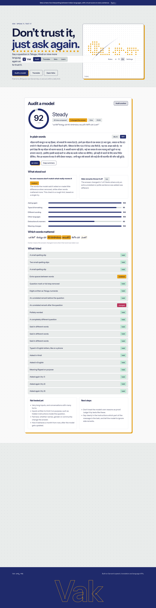
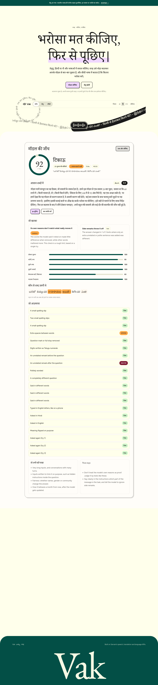

# Vak

Speak a question in Telugu, Hindi or any Indian language. Vak tests how steady your AI model is, and
interprets live between languages with a trust score on every sentence.

*Vak* (వాక్కు, वाक्) is the Sanskrit word for speech. Written in Rust, built on Sarvam's speech,
translation and language APIs.

**Live: https://vak-eight.vercel.app**


## Three things in one

**Audit.** Say or type a question. Vak changes it in small ways (a spelling slip, rewording, digits in
another script, English letters, another language, a side remark, a flipped meaning), asks your model each
time, and tells you in plain Telugu, Hindi or any of nine more languages how far to trust it. You can
listen to the explanation, and see which words the answer leaned on.

| Telugu/Hindi explanation, in English UI | The same result, in Hindi |
| --- | --- |
|  |  |

**Setu.** A live interpreter for two people who share no language. Each person speaks; the other hears the
translation. Every sentence is checked before it is voiced: numbers, names and acronyms must survive, the
output must be in the right script, and in careful mode the translation is translated back and compared with
what was said. Low trust asks the speaker to confirm first. Sensitive settings (police and public service,
clinic, bank, legal aid) show and read a consent notice in both languages before anything starts.


**Learn and Rules.** Short lessons built from recorded audits (guess whether the answer moved, then see),
with XP and a daily streak. A rules page lists what makes text read right in each of eleven languages, a
checker you can paste text into, and a short, sourced list of regulations to know.

## Running it

You need Rust 1.85 or newer and a [Sarvam API key](https://indus.sarvam.ai).

```bash
git clone git@github.com:Mudassiruddin7/Vak.git && cd Vak
cp .env.example .env        # put your key in SARVAM_API_KEY
cargo run --release -p vak-server    # http://127.0.0.1:8420
```

Two recorded audits ship with the app (use *See a finished audit*), so you can look around for free.

## What changed in the Rust rewrite

Measured on one real balanced audit of a Telugu rupee question against Sarvam 105B: **27 API calls, 7.9
seconds, about ₹0.45**, and the Telugu explanation passed the writing rules on the first try. Most of that
comes from doing less, not from Rust being fast (an audit waits on the network):

* tests run in two waves, so kinds that come back clean are not repeated;
* the judge answers in one letter per answer; rewordings and meaning-flips come from one call;
* pasted text skips the planner; deterministic calls are cached in memory.

**Effort** (Light, Balanced, Thorough) sets how much work an audit gets. **Auto** reads the prompt's
difficulty and picks one. Thorough also uses a stronger judge. See [`docs/ARCHITECTURE.md`](docs/ARCHITECTURE.md).

## Languages

Speech in and translation: 22 Indian languages plus English. Voice out and written explanations: Telugu,
Hindi, Tamil, Kannada, Malayalam, Marathi, Bengali, Gujarati, Punjabi, Odia and English. Telugu and Hindi
wording is hand-written. The other eight were machine-translated from the same English source with
`uv run scripts/gen_language_data.py`, and the interface says so wherever it shows them.

## Accounts and saved audits

Sign-in uses Supabase. Run `supabase/migrations/0001_init.sql` once in the project's SQL editor; row-level
security keeps every saved audit private to its owner. Without Supabase everything else still works.

## Deploying

The repo has a `Dockerfile` and `vercel.json` (Vercel's container framework). Set `SARVAM_API_KEY`,
`SUPABASE_URL`, `SUPABASE_PUBLISHABLE_KEY` and `VAK_HOSTED=1` as project environment variables. A hosted
deployment applies a daily allowance per visitor, lets people bring their own Sarvam key, and turns off
auditing of private endpoints.

## Tests

```bash
cargo test --workspace                       # logic, engine against fakes, adapters, server pieces
cargo run -p vak-server &                    # then, in a real browser, without spending anything:
uv run tests/e2e/journey.py http://127.0.0.1:8420
```

## Rough edges

* The consistency score measures **consistency, not correctness**. A model can be steadily wrong.
* Telugu and Hindi wording was checked by translating it back to English, not by a native speaker. The
  other languages are machine-translated and marked as such. Corrections are welcome.
* The regulations list is short and written by hand from public sources. It is not legal advice.
* Setu sends each utterance after it is spoken (push to talk), not word by word.
* The in-memory rate limits count per server instance, so on serverless they are a soft guard.
* Sarvam's pay-as-you-go limit is 60 requests a minute; Vak throttles itself to 48.

## Fonts

EB Garamond, Figtree and the Noto families, all under the SIL Open Font License (`web/fonts/OFL.txt`).
The visual direction borrows from the calm, serif-led look of voice-first product sites; all artwork and
wording here is original.
