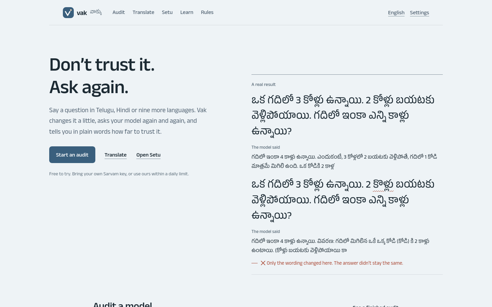
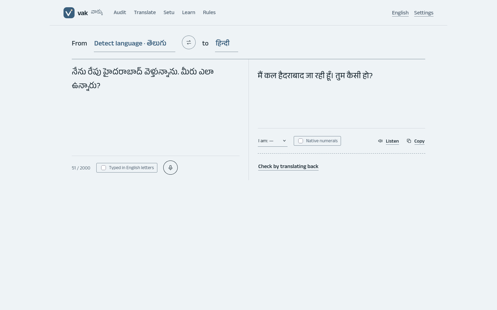
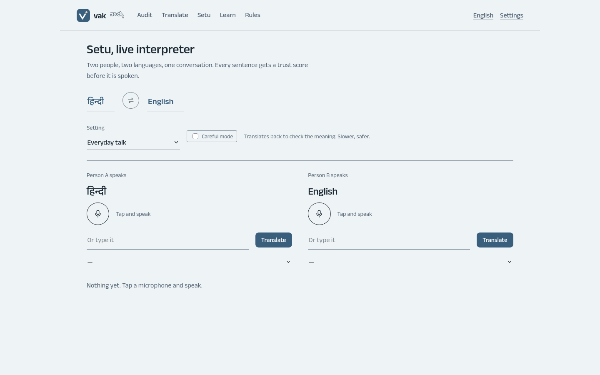

# Vak

Ask an AI model the same question many ways, in Telugu, Hindi or any Indian language, and see how steady it is. Also a 23-language translator and a live interpreter.

**Live: https://vak-eight.vercel.app**



## The four tools

- **Audit**: say a question. Vak rewords it, mistypes it, translates it, asks your model each time, then explains in plain words how far to trust it.
- **Translate**: 23 languages, auto-detect, type in English letters, hear it read back.
- **Setu**: live interpreter for two people. Every sentence gets a trust score before it is spoken.
- **Learn and Rules**: short lessons from real audits, and writing rules and regulations for each language.

| Translate | Setu |
| --- | --- |
|  |  |

## Run it

```bash
cp .env.example .env            # put your Sarvam key in SARVAM_API_KEY
cargo run --release -p vak-server    # http://127.0.0.1:8420
```

## Good to remember

- **Languages:** 23 for speech in, translation, explanations and the interface. 11 also have a voice. Telugu and Hindi wording is hand-written; the rest is machine-translated and marked as such.
- **Cost:** an audit is about ₹0.3 to ₹1.5. The estimate shows before you run it. Light, Balanced and Thorough set how much work it does; Auto picks for you.
- **Tests:** `cargo test --workspace`, then `uv run tests/e2e/journey.py http://127.0.0.1:8420` for the browser.
- **Deploy:** `Dockerfile` and `vercel.json`. Set `SARVAM_API_KEY`, `SUPABASE_URL`, `SUPABASE_PUBLISHABLE_KEY`, `VAK_HOSTED=1`.
- **Saving audits:** run `supabase/migrations/0001_init.sql` once in Supabase.
- **Where things are:** `crates/` is the Rust backend, `web/` is the site. More in [docs/ARCHITECTURE.md](docs/ARCHITECTURE.md).

## Limits

The score measures consistency, not correctness. Setu is push-to-talk, not word by word. The regulations list is short and is not legal advice.
